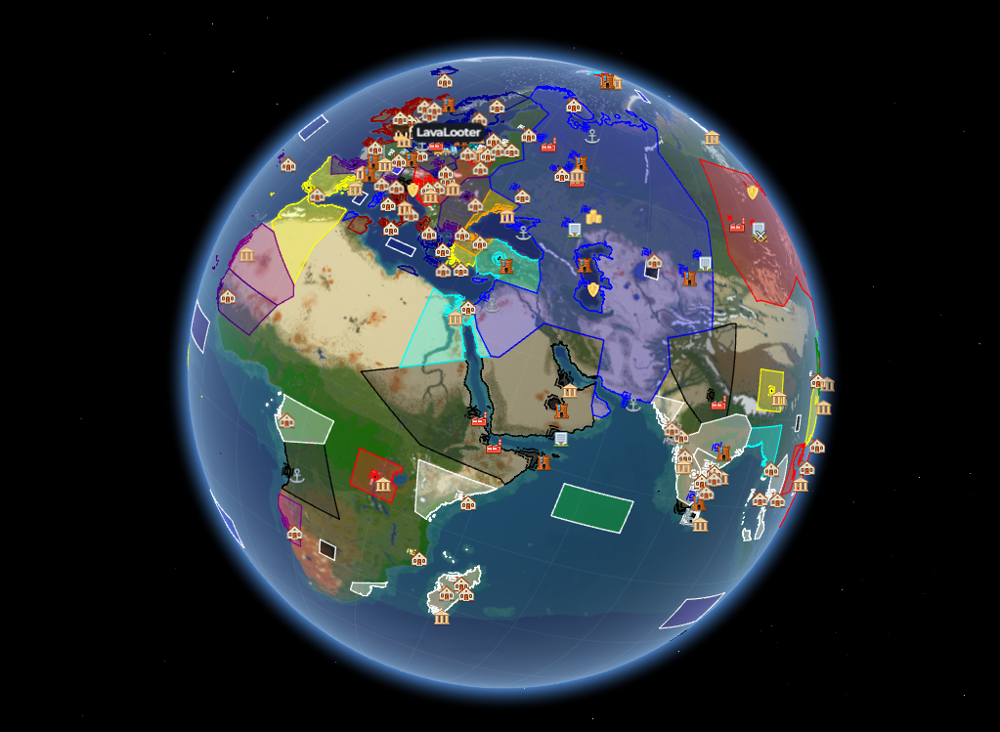

---
I help maintain and run a Minecraft server and the interactive web experiences around them.

# [SovereignMC](https://sovereignmc.net)

The SovereignMC website server info, how to join, store, leaderboards, nation pages, rules, live war/battle tracking, and the interactive world map, all in one Next.js app.

### [Globe / Flat Map](https://sovereignmc.net/map)

An interactive, browser-based map that lets players explore the SovereignMC world in both **Globe** and **Flat** projections.

- **Live Demo:** [https://sovereignmc.net/map](https://sovereignmc.net/map)
- **Features:** WebGL globe · Leaflet flat map · coordinate navigation · live player positions · town/nation/battle layers · shareable view state

> *This is the project I'm most proud of*

---

### 📊 Stats

### 📫 Connect
- **Discord:** `doml.`

*⭐ If you like the SovereignMC map, feel free to reach out!*
